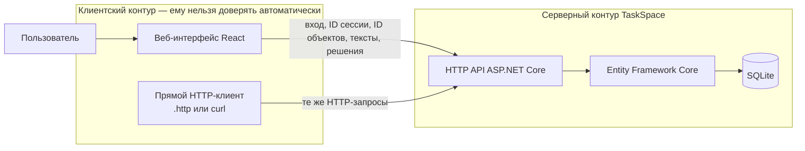

# Модель угроз

Эта модель относится к **TaskSpace**. Как устроен продукт и какие данные в нём важны, описано в [PROJECT.md](PROJECT.md). Требования безопасности и критерии их проверки — в [security-requirements.md](security-requirements.md).

## Как устроен продукт

Пользователь сможет работать через React-интерфейс или посылать запросы в API напрямую. Для сервера это одинаково недоверенный клиент: он может изменить любой параметр, скрыть его или повторить запрос.

В API входят:

- данные для входа и идентификатор сессии;
- идентификаторы команды, задачи и участников;
- название и описание задачи, текст сдачи и замечание;
- действие автора: принять результат или вернуть его на доработку.

Сервер по действующей сессии определяет пользователя, проверяет его членство в команде и роль в задаче, а затем решает, можно ли выполнить действие. Веб-интерфейс к SQLite не обращается: с базой через Entity Framework Core работает только сервер.

**Что есть сейчас:** локальный API, файловая SQLite, React и автоматические проверки M1–M3. Фактические результаты прежней версии приведены в `docs/M2_*.md` и `docs/M3_CHECKS.md`.

**Расширение после EK1 (2026-10-23):** T-08–T-12 и планы D-06–D-09 добавляют доступность, ограничение ресурсов и восстановление. Они не реализованы и не подтверждены прежними тестами; тег `ek1` не меняется.

**Важные допущения:**

- Первая версия запускается локально. Публикация API в недоверенную сеть и доступ других пользователей ОС к файлу SQLite пока не входят в границу продукта.
- Ограничения в React не считаются защитой: сервер всё равно проверяет каждый запрос.
- Текстовые поля не поддерживают HTML и Markdown. React входит в локальную версию и показывает их как обычный текст согласно SR-11.
- D-01–D-05 реализованы в локальной версии; DOM-проверка D-05 использует HTTP-фикстуру, а не полный браузерный E2E. Новые D-06–D-09 — планы, не свидетельства.
- Сессия передаётся явным заголовком `Authorization: Bearer`, токен React хранится в памяти. Перехват действующего токена позволяет использовать сессию; генерация случайного значения защищает от угадывания, но не от уже произошедшей кражи. Ограничения этого решения приведены в D-01. Если меняем способ передачи на cookie, отдельно рассматриваем CSRF.

## Граница доверия

| Граница                | Что через неё проходит                                                                                                        | Почему сервер это проверяет                                                                                                                                                       |
| ---------------------- | ----------------------------------------------------------------------------------------------------------------------------- | --------------------------------------------------------------------------------------------------------------------------------------------------------------------------------- |
| TB-01: клиент → сервер | Данные для входа, идентификатор сессии, ID команды, задачи и участников, параметры просмотра, текстовые поля и решения автора | Любой из этих параметров можно изменить в прямом HTTP-запросе. Сервер сам устанавливает пользователя по сессии, проверяет доступ к команде, роль в задаче и её текущее состояние. |
| TB-02: рабочая база → резервная копия и обратно | Предметные данные, учётные записи, контроль целостности копии | При восстановлении нельзя принять повреждённую/несогласованную копию или воскресить старые сессии. Операцию выполняет оператор ОС, не пользователь API; механизм D-09 пока запланирован. |

Сервер и SQLite находятся в одном локальном контуре. В модель добавлены ограниченный ресурсный бюджет локального процесса и аварийное восстановление оператором. Общая машина, недоверенный администратор, внешняя публикация и сетевой DDoS остаются за границей: для них понадобятся отдельные решения по HTTPS, правам ОС и сетевой защите.

## Что защищаем

Подробный список есть в [разделе 5 паспорта](PROJECT.md#5-значимые-данные-и-другие-объекты). Здесь важнее всего следующее:

- нельзя работать от имени другого пользователя;
- участник одной команды не должен видеть задачи и результаты другой;
- у задачи должны оставаться правильные автор, исполнитель и состояние;
- сдачи и решения нельзя подменить, потерять или выполнить как код в браузере другого участника;
- API должен сохранять доступность в объявленном профиле нагрузки, расход памяти/соединений/диска ограничивается;
- предметные данные должны восстанавливаться из пригодной копии с измеряемыми RPO/RTO (новый план).

## Угрозы

| ID   | Сценарий                                                                                                                                                                                                                                              | Что ломается                                                               | Где возникает                                | Связанные SR                      | Приоритет и почему                                                                                                                                          |
| ---- | ----------------------------------------------------------------------------------------------------------------------------------------------------------------------------------------------------------------------------------------------------- | -------------------------------------------------------------------------- | -------------------------------------------- | --------------------------------- | ----------------------------------------------------------------------------------------------------------------------------------------------------------- |
| T-01 | Посторонний подставляет отсутствующий, изменённый, угаданный или чужой идентификатор сессии. Если сервер принимает его за настоящую сессию, человек получает доступ к чужим данным и меняет задачи от имени владельца.                                | Идентичность пользователя, конфиденциальность и целостность данных команд. | TB-01; любой защищённый запрос.              | SR-01, SR-09                      | **Высокий.** Такой сбой обходит остальные проверки и затрагивает все сценарии.                                                                              |
| T-02 | Участник команды A знает ID команды, задачи, сдачи или решения команды B и подставляет его в запрос просмотра. Если сервер проверяет только существование ID, он получает чужие данные.                                                               | Изоляция команд и конфиденциальность заданий, сдач и замечаний.            | TB-01; параметры просмотра и ID объектов.    | SR-03                             | **Высокий.** Прямой HTTP-запрос сделать легко, а раскрытие чужой работы для продукта критично.                                                              |
| T-03 | Пользователь подменяет в запросе создания задачи команду, автора или исполнителя. Если сервер берёт эти значения из запроса и не сверяет с сессией и членством, задача появляется в чужой команде или от чужого имени.                                | Принадлежность к команде и достоверность ответственности за задачу.        | TB-01; создание задачи.                      | SR-02, SR-04                      | **Высокий.** Это первый основной сценарий, а подмена полей возможна при прямом вызове API.                                                                  |
| T-04 | Участник команды, который не назначен исполнителем, напрямую отправляет сдачу по чужой задаче. Если сервер полагается на скрытую кнопку в интерфейсе, ложная сдача попадает в историю, а задача уходит на проверку.                                   | Полномочия исполнителя, достоверность сдачи и состояние задачи.            | TB-01; сдача результата.                     | SR-05, SR-08                      | **Высокий.** Можно выдать чужую работу за результат исполнителя в основном сценарии сдачи.                                                                  |
| T-05 | Участник, который не создавал задачу, напрямую отправляет принятие или возврат результата. Если сервер не проверяет автора и состояние задачи, незавершённую работу примут или в истории появится чужое замечание.                                    | Полномочия автора, состояние задачи и история решений.                     | TB-01; принятие или возврат результата.      | SR-06, SR-08                      | **Высокий.** Угроза напрямую ломает сценарии принятия и доработки.                                                                                          |
| T-06 | Исполнитель дважды отправляет сдачу или автор почти одновременно отправляет «принять» и «вернуть». Если сервер отдельно проверяет состояние и отдельно сохраняет результат, могут появиться две сдачи, два разных решения или противоречивая история. | Согласованность переходов, история и состояние принятой задачи.            | TB-01; сдача, принятие и возврат результата. | SR-05, SR-06, SR-07, SR-08, SR-10 | **Средний.** Повторные и параллельные запросы реальны при прямом API и повторной отправке. Они не открывают чужую команду, но портят историю задачи.        |
| T-07 | Участник записывает HTML или JavaScript в название, описание, сдачу или замечание. Если React покажет это как разметку, код выполнится, когда страницу откроет другой участник.                                                                       | Сессия и действия пользователя, который просматривает страницу.            | TB-01; текстовые поля и их вывод в React.    | SR-11                             | **Средний.** Угроза актуальна, пока React остаётся в продукте. Для неё нужно небезопасно отрисовать текст, но последствия затрагивают другого пользователя. |

| T-08 | Клиент создаёт поток запросов, в том числе медленно передаёт тела. Без ограничения частоты, параллелизма и времени приёма запросы занимают CPU, память и соединения, мешая другим участникам читать и сдавать задачи. | Доступность API и ресурсы процесса. | TB-01; HTTP/Kestrel, вход и остальные методы. | SR-12, SR-17 | **Высокий.** Не требует нарушения прав; ограниченные ресурсы одного локального процесса общие для всех команд. Не утверждается устойчивость к распределённому сетевому DDoS. |
| T-09 | Посторонний многократно пробует пароли к известному логину. Без ограничения попыток онлайн-перебор позволяет захватить аккаунт; солёный хеш в базе этого не предотвращает. | Конфиденциальность учётных данных и идентичность. | TB-01; POST /api/auth/login. | SR-13 | **Высокий.** Вход доступен без сессии; захват аккаунта открывает его полномочия. От T-08 отличается целью — подбор пароля, а не перегрузка. |
| T-10 | Участник накапливает много задач/сдач и повторяет чтение списка или полной истории. Неограниченная выборка и совместная загрузка коллекций увеличивают работу БД, память и размер ответа даже при небольшой частоте запросов. | Доступность чтения и бюджет памяти. | TB-01; чтение списка/истории → EF Core → SQLite. | SR-14 | **Высокий.** Сейчас нет пагинации, история загружается целиком; одного разрешённого запроса может быть достаточно для большого расхода ресурсов. Масштаб последствий требует измерения. |
| T-11 | Авторизованный участник постепенно создаёт множество допустимых задач и результатов либо сессий. Файл SQLite, WAL и журналы занимают свободное место; новые записи и другие операции перестают выполняться. | Ёмкость хранилища, доступность записи, сохранность истории. | API → SQLite и локальный диск. | SR-15, SR-18 | **Средний.** Нужны время и накопление данных; лимит отдельного запроса не ограничивает общий объём. |
| T-12 | Сбой носителя, повреждение или ошибочное удаление файла базы уничтожает задачи и историю; без проверенной резервной копии восстановление невозможно. Это эксплуатационный риск, не действие удалённого злоумышленника. | Восстановимость и долговременная сохранность данных. | TB-02; SQLite → резервная копия → восстановление оператором. | SR-16 | **Средний.** Событие реже обычных запросов, но потеря единственного файла затрагивает все команды. Защита от администратора-вредителя не заявляется. |

## Приоритетный набор

Исходный приоритетный набор EK1 — **T-01–T-05**. После расширения в текущем плане приоритетны также **T-08, T-09, T-10**: доступность и ресурсы не защищены одними проверками роли. Для всего набора цепочки приведены в [сводке D](security-design.md#сводка-связей). Новые приоритетные меры ещё не реализованы — комплект не выдаётся за полностью защищённую версию.

T-06 и T-07 сохраняются со средним приоритетом; React входит в версию, поэтому T-07/SR-11/D-05 применимы. T-11 и T-12 средние из-за накопительного характера/реже возникающего события, но планы защиты включены.

## Уточнения S04

- T-01: D-01 закрывает отсутствие, подмену и угадывание сессии, а также раскрытие исходного пароля. Повтор уже украденного действующего токена остаётся риском до реализации SR-18/D-07; после их реализации риск сохраняется до отзыва или истечения срока. Сетевой перехват вне текущей локальной границы; путь к краже через пользовательский текст рассматривается в T-07/D-05. Перед внешним запуском модель пересматривается.
- T-06: учитываем не только одновременные запросы, но и старое действие из вкладки автора после возврата R1 и новой сдачи R2. Одинаковый статус «На проверке» не означает, что решение относится к той же сдаче. Контрпример, уточнение SR-06/SR-10 и проверка приведены в [D-04](security-design.md#пограничный-случай-старое-решение-и-новая-сдача). Приоритет остаётся средним, решение уже включено в комплект.
- Для всех приоритетных T-01–T-05 есть решения и планы проверки: D-01 — сессия, D-02 — команда и объекты, D-03 вместе с D-04 — полномочия, переходы и отсутствие частичной записи. Полный обзор связей — в [решениях](security-design.md#сводка-связей).

## Трассировка расширения и границы подтверждения

- T-08 → SR-12, SR-17 → D-06 → превышение частоты/параллелизма, большое и медленное тело, обслуживание второго клиента.
- T-09 → SR-13 → D-07 → лимиты логина и источника, восстановление входа после окна.
- T-10 → SR-14 → D-08 → ограниченные страницы, авторизация курсора и объём выборки на большой базе.
- T-11 → SR-15, SR-18 → D-08, D-07 → атомарная квота, SQLITE_FULL, очистка сессий.
- T-12 → SR-16 → D-09 → восстановление согласованной копии с измерением RPO/RTO.
- Уточнение T-01 → SR-18 → D-07 → истёкший/отозванный токен не принимается.

Это планы. Отсутствие лимитов установлено чтением кода, но успешная атака на доступность и соответствие новым порогам не проверялись. Эксперименты — только на изолированном локальном стенде с временной базой.
